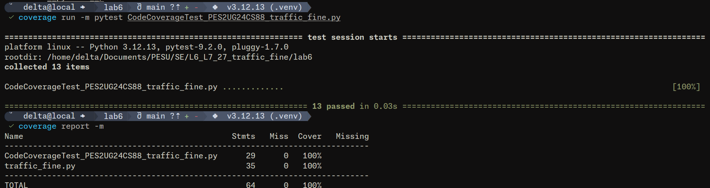
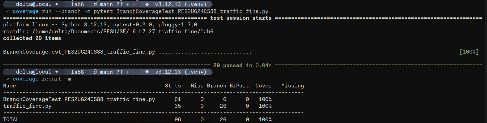

# Lab 6 Submission — Code and Branch Coverage

**Name:** Vinaayak G Dasika
**Student SRN:** PES2UG24CS88  
**Module:** Traffic Fine Calculator (`traffic_fine.py`)

## 1. Code Coverage Analysis

Run:
```bash
coverage run -m pytest CodeCoverageTest_PES2UG24CS88_traffic_fine.py
coverage report -m
```

Result: 100% statement coverage on `traffic_fine.py`.



## 2. Branch Coverage Analysis

Run:
```bash
coverage run --branch -m pytest BranchCoverageTest_PES2UG24CS88_traffic_fine.py
coverage report -m
```

Result: 100% branch coverage on `traffic_fine.py`.



## 3. Test Files

- `test_traffic_fine.py` — combined test suite
- `CodeCoverageTest_PES2UG24CS88_traffic_fine.py` — code coverage tests
- `BranchCoverageTest_PES2UG24CS88_traffic_fine.py` — branch coverage tests

## 4. Commits

1. Add code coverage tests for traffic fine module
2. Add branch coverage tests for traffic fine module
3. Add named code and branch coverage test deliverables
4. Add screenshots and submission report
